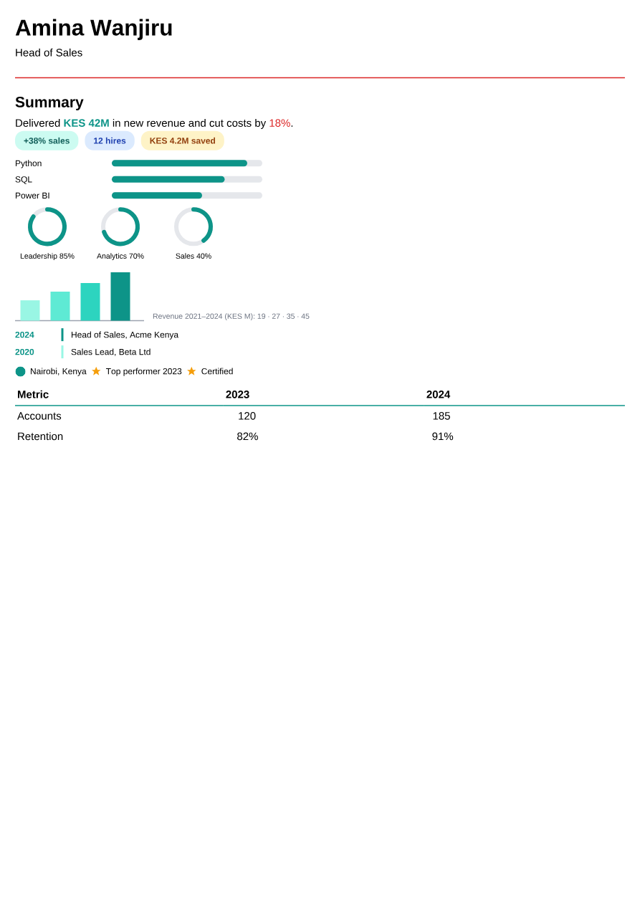

# Rich content in summaries and descriptions

This guide is for people and AI models writing HTML into a resume's rich-text fields so an infographic CV looks premium in the PDF. It describes exactly what the PDF engine draws, gives snippets you can paste, and says what breaks ATS parsing.

It applies to every field the schema describes as "HTML-formatted": `summary.content`, and the `description` of experience, education, projects, awards, certifications, publications, volunteer and reference items, custom section items, and cover letter `content`.

The snippets mirror `packages/pdf/src/rich-content.fixture.ts`, which `packages/pdf/src/rich-content.integration.test.tsx` renders in the `onyx`, `azurill` and `bronzor` templates (and checks that hostile markup is neutralised). If you change a snippet's structure, change the fixture too. This is the fixture rendered in `onyx`:



## 1. Decide first: ATS CV or infographic CV

| The document is…                                                                    | Write                                                                                                                                             | Why                                                                                                                                     |
| ----------------------------------------------------------------------------------- | ------------------------------------------------------------------------------------------------------------------------------------------------- | --------------------------------------------------------------------------------------------------------------------------------------- |
| An **ATS CV**, or any CV sent through an applicant tracking system or job portal    | **Plain text only**: `<p>`, `<ul>`/`<ol>`/`<li>`, `<strong>`, `<em>`, `<a>`. No `<div>`, `<table>`, `<svg>` or ``. Use an ATS-safe template. | ATS parsers read the PDF's text layer in reading order. Drawings carry no text, and side-by-side boxes can come out in the wrong order. |
| An **infographic CV** for a human reader (sent directly, printed, shared as a link) | Everything in this guide.                                                                                                                         | The PDF draws it faithfully.                                                                                                            |

**ATS-safe templates** (one column, plain headings): `bronzor`, `kakuna`, `lapras`, `meowth`, `onyx`, `persian`, `porygon`, `rhyhorn`, `scizor`, `smeargle`. The two-column templates (`azurill`, `chikorita`, `ditgar`, `ditto`, `gengar`, `glalie`, `leafish`, `pikachu`) are not ATS-safe.

### What breaks ATS parsing

- **Facts that exist only in a drawing.** An SVG skill bar or ring has no text. If the bar means "Python, 90%", the word `Python` must also be HTML text next to it (all the snippets below do this). Never put text inside an SVG: SVG `<text>` is not drawn at all.
- **Facts that exist only in an image.** `` has no text layer and `alt` is ignored.
- **Side-by-side layouts.** Flex rows and tables are read left to right, top to bottom, cell by cell. A two-column table of "Skill | Years" reads as `Skill Years Python 5 SQL 3`, which loses the pairing. Keep each fact in one cell or one line.
- **Tiny or pale text.** Below 7pt, or light grey on white, some parsers drop it and OCR-based ones misread it.
- **Headings drawn as decoration.** A section title must be the template's heading, not a styled `<div>`.
- **Icons in place of words.** Write "Phone: +254 …", not a phone icon followed by the number.

A safe middle ground for an ATS CV is the **styled text** snippet (section 4.1): coloured, bold numbers inside ordinary sentences. It changes nothing for a parser.

## 2. How the HTML is drawn

The PDF engine (Forme, via `packages/pdf/src/text.tsx`) turns HTML into PDF boxes. It is not a browser. Know these rules:

1. **Every element is either a box or text.** Inline tags (`span`, `strong`, `b`, `em`, `i`, `u`, `s`, `a`, `code`, `mark`, `sub`, `sup`, `small`, `br`) flow inside a line of text. Every other tag (`p`, `div`, `table`, `tr`, `td`, `ul`, `li`, `h1`–`h6`, `svg`, `img`, …) is a box.
2. **Boxes stack vertically by default** (`flex-direction: column`). To put things side by side, the parent must say `display: flex; flex-direction: row`.
3. **Put drawings and images in a `<div>`, never inside a `<p>`, `<li>` or `<span>`.** A paragraph is one line of text; a box inside it breaks the layout.
4. **Only inline `style="…"` attributes style anything.** `class`, `id`, `<style>` blocks and stylesheets do nothing. `<style>`, `<script>` and their contents are removed.
5. **Units:** `pt` is the native unit; `px` is treated as `pt`; `mm`, `cm`, `in`, `em`, `rem` work; `%` works for `width`, `height`, `min-/max-width/height` and `flex-basis` only.
6. **Colours:** `#rgb`, `#rrggbb`, `#rrggbbaa`, `rgb()`, `rgba()`, and common named colours (`black`, `white`, `teal`, `navy`, `crimson`, …). Prefer hex: an unknown name is dropped. Translucent colours are drawn by mixing with the background behind them, which is exact on solid backgrounds.
7. **Widths must fit the column.** An A4 page's content is about 540pt wide. The main column of a two-column template is about 340pt and the sidebar about 180pt. Anything wider than its column is clipped or squeezed; use `%` widths, or keep fixed widths at or below 160pt for content that may land in a sidebar.

## 3. The supported subset

### 3.1 HTML elements

| Element                                                                | Use                                         | Notes                                                                                                                         |
| ---------------------------------------------------------------------- | ------------------------------------------- | ----------------------------------------------------------------------------------------------------------------------------- |
| `p`, `h1`–`h6`, `ul`, `ol`, `li`, `blockquote`, `hr`, `br`, `pre`      | Normal prose                                | Templates style these; don't override fonts here.                                                                             |
| `strong`, `b`, `em`, `i`, `u`, `s`, `strike`, `code`, `a href`, `mark` | Inline emphasis                             | `a` keeps its link in the PDF.                                                                                                |
| `span style`                                                           | Coloured or sized words inside a line       | Text properties only (see 3.2). Background colour on a `span` is **not** drawn: use a `div` chip.                             |
| `div style`                                                            | Layout boxes: chips, rows, cards, timelines | The main building block.                                                                                                      |
| `table`, `tbody`, `tr`, `td`, `th`                                     | Simple grids                                | Rows lay out horizontally; cells share the width equally unless given `width`. `th` is bold. `colspan`/`rowspan` are ignored. |
| `svg` (inline)                                                         | Skill bars, rings, charts, dividers         | Shapes only; see 3.3.                                                                                                         |
| `img src="data:…"`                                                     | Small icons and logos                       | Data URIs only; see 3.4.                                                                                                      |

Anything else is drawn as a plain box around its text, except these, which are removed with their contents: `script`, `style`, `template`, `noscript`, `iframe`, `object`, `embed`, `head`, `title`, `meta`, `link`, `base`, `video`, `audio`, `canvas`.

### 3.2 CSS properties (in `style="…"`)

**Drawn:**

| Group                 | Properties                                                                                                                                                                                                                                                                                                                                               |
| --------------------- | -------------------------------------------------------------------------------------------------------------------------------------------------------------------------------------------------------------------------------------------------------------------------------------------------------------------------------------------------------- |
| Box size              | `width`, `height`, `min-width`, `min-height`, `max-width`, `max-height`                                                                                                                                                                                                                                                                                  |
| Spacing               | `margin`, `margin-top/right/bottom/left`, `padding`, `padding-top/right/bottom/left` (shorthands with 1–4 values work)                                                                                                                                                                                                                                   |
| Flex                  | `display: flex`, `flex-direction`, `flex-wrap`, `justify-content`, `align-items`, `align-self`, `align-content`, `flex`, `flex-grow`, `flex-shrink`, `flex-basis`, `gap`, `row-gap`, `column-gap`                                                                                                                                                        |
| Position              | `position: relative/absolute`, `top`, `right`, `bottom`, `left`                                                                                                                                                                                                                                                                                          |
| Background and border | `background-color` (or `background` with a plain colour), `border`, `border-top/right/bottom/left` (e.g. `1pt solid #0d9488`), `border-width`, `border-color`, `border-radius` and its corners, `opacity`, `overflow: hidden`                                                                                                                            |
| Text                  | `color`, `font-size`, `font-weight` (100–900 or `bold`), `font-style`, `line-height`, `letter-spacing`, `text-align`, `text-decoration` (`underline`, `line-through`), `text-transform`, `font-family` (only the resume's own body/heading fonts or `Helvetica`, `Times-Roman`, `Courier`: rich text never loads a font, so any other family falls back) |

**Not drawn (silently dropped):** `display: grid` (stacks instead: use flex rows), `display: inline-block`/`inline-flex`, `transform` and `rotate`, `box-shadow`, `text-shadow`, gradients and `background-image`, `filter`, `float`, `z-index`, CSS variables, `calc()`, `vw`/`vh`. Dashed and dotted borders are drawn solid.

### 3.3 Inline SVG

Write a complete `<svg>` with `width`, `height` and `viewBox`. Sizes are in points; if only `viewBox` is given, its size is used; if only one of width/height is given, the other follows the viewBox's aspect ratio. Drawings are capped at 540pt.

| Allowed               |                                                                                                                                                                                                                                                       |
| --------------------- | ----------------------------------------------------------------------------------------------------------------------------------------------------------------------------------------------------------------------------------------------------- |
| Elements              | `g`, `rect`, `circle`, `ellipse`, `line`, `polyline`, `polygon`, `path` (all path commands, including arcs `A` and curves `C`/`Q`)                                                                                                                    |
| Attributes            | `x`, `y`, `x1`, `y1`, `x2`, `y2`, `cx`, `cy`, `r`, `rx`, `ry`, `width`, `height`, `d`, `points`, `fill`, `fill-opacity`, `fill-rule`, `stroke`, `stroke-width`, `stroke-opacity`, `stroke-linecap`, `stroke-linejoin`, `stroke-miterlimit`, `opacity` |
| `style="…"` on shapes | Only the attributes above, e.g. `style="fill: #0d9488"`; they become attributes.                                                                                                                                                                      |

`rect` with `rx`/`ry` is drawn rounded. A shape with no `fill` is filled black, like in a browser; write `fill="none"` for outlines.

**Removed:** `text` and `tspan` (Forme doesn't draw text: put labels in HTML next to the SVG), `transform` (use absolute coordinates), `stroke-dasharray`/`stroke-dashoffset` (draw rings with arc paths, as in 4.4), `defs`, gradients, patterns, filters, masks, clip paths, `use`, `image`, `a`, `foreignObject`, `style` elements, scripts, event handlers (`onload`, …), `class`, `id`, and any value containing `url(`, `javascript:` or `data:`.

### 3.4 Images

`` draws only **data URIs**:

- `data:image/png;base64,…`, `data:image/jpeg;base64,…` (or `image/jpg`), `data:image/webp;base64,…`
- `data:image/svg+xml;base64,…` or URL-encoded `data:image/svg+xml,…`, which are drawn as inline SVG with the rules in 3.3.

Give both `width` and `height` (in pt). Without them the picture fills its column. Images are capped at 540pt on each side.

**Never drawn:** `http(s)://` URLs, relative paths, GIF, BMP, `srcset`. Rich text never fetches anything: a remote image is simply left out. Use the resume's profile picture field for photos.

### 3.5 Limits

| Limit                         | Value                                                                                                          |
| ----------------------------- | -------------------------------------------------------------------------------------------------------------- |
| One image data URI            | 1.5 MB of text (about 1.1 MB of image). Keep icons under 5 KB; the whole resume is saved as one JSON document. |
| Drawn size of an image or SVG | 540pt per side                                                                                                 |
| Page content width (A4)       | about 540pt; two-column main ≈ 340pt, sidebar ≈ 180pt                                                          |
| Smallest readable text        | 7pt (6pt for labels under charts at most)                                                                      |

## 4. Snippets

Replace the numbers and colours; keep the structure. `#0d9488` (teal) and the pale tints are examples; take colours from the resume's theme when you can.

### 4.1 Styled text (safe for ATS CVs)

```html
<p>
  Delivered <span style="color: #0d9488; font-weight: bold">KES 42M</span> in new revenue and cut costs by
  <span style="color: #dc2626">18%</span>.
</p>
```

### 4.2 Metric chips

```html
<div style="display: flex; flex-direction: row; flex-wrap: wrap; gap: 6pt; margin-bottom: 6pt">
  <div
    style="background-color: #ccfbf1; color: #115e59; padding: 3pt 8pt; border-radius: 8pt; font-size: 8pt; font-weight: bold"
  >
    +38% sales
  </div>
  <div
    style="background-color: #dbeafe; color: #1e40af; padding: 3pt 8pt; border-radius: 8pt; font-size: 8pt; font-weight: bold"
  >
    12 hires
  </div>
  <div
    style="background-color: #fef3c7; color: #92400e; padding: 3pt 8pt; border-radius: 8pt; font-size: 8pt; font-weight: bold"
  >
    KES 4.2M saved
  </div>
</div>
```

Chips must be `div`s: a `span` with a background is drawn without it.

### 4.3 Skill bars

One row per skill. The bar's filled width is `track width × percent / 100` (here 140 × 0.9 = 126).

```html
<div style="display: flex; flex-direction: row; align-items: center; margin-bottom: 3pt">
  <div style="width: 90pt; font-size: 8pt">Python</div>
  <svg width="140" height="6" viewBox="0 0 140 6">
    <rect x="0" y="0" width="140" height="6" rx="3" fill="#e5e7eb" />
    <rect x="0" y="0" width="126" height="6" rx="3" fill="#0d9488" />
  </svg>
</div>
```

In a sidebar (≈180pt), use a 60pt label and a 100-wide bar (`width="100" viewBox="0 0 100 6"`).

### 4.4 Progress rings

A grey track circle plus a teal arc. For radius 16 centred at (20, 20), the arc starts at the top `(20, 4)` and ends at angle `θ = percent/100 × 360° − 90°`: `x = 20 + 16·cos θ`, `y = 20 + 16·sin θ`. Set the large-arc flag (4th number after `A`) to `1` when percent > 50, else `0`. For 100%, draw a full teal circle instead of an arc.

```html
<div style="display: flex; flex-direction: row; gap: 8pt; margin-bottom: 6pt">
  <div style="display: flex; flex-direction: column; align-items: center; width: 60pt">
    <svg width="40" height="40" viewBox="0 0 40 40">
      <circle cx="20" cy="20" r="16" fill="none" stroke="#e5e7eb" stroke-width="4" />
      <path d="M 20 4 A 16 16 0 1 1 7.06 10.60" fill="none" stroke="#0d9488" stroke-width="4" stroke-linecap="round" />
    </svg>
    <div style="font-size: 7pt; margin-top: 2pt">Leadership 85%</div>
  </div>
  <div style="display: flex; flex-direction: column; align-items: center; width: 60pt">
    <svg width="40" height="40" viewBox="0 0 40 40">
      <circle cx="20" cy="20" r="16" fill="none" stroke="#e5e7eb" stroke-width="4" />
      <path d="M 20 4 A 16 16 0 0 1 29.40 32.94" fill="none" stroke="#0d9488" stroke-width="4" stroke-linecap="round" />
    </svg>
    <div style="font-size: 7pt; margin-top: 2pt">Sales 40%</div>
  </div>
</div>
```

Precomputed end points (radius 16, centre 20,20): 25% → `36 20` (flag 0), 40% → `29.40 32.94` (0), 50% → `20 36` (0), 60% → `10.60 32.94` (1), 70% → `4.78 24.94` (1), 75% → `4 20` (1), 80% → `4.78 15.06` (1), 85% → `7.06 10.60` (1), 90% → `10.60 7.06` (1).

### 4.5 Mini bar chart

Bars are `rect`s standing on a baseline at `y = 49`; a bar of value `v` on a scale whose top is `max` has `height = 45 × v / max` and `y = 49 − height`. Put the numbers in HTML text beside it.

```html
<div style="display: flex; flex-direction: row; align-items: flex-end; gap: 8pt; margin-bottom: 6pt">
  <svg width="120" height="50" viewBox="0 0 120 50">
    <line x1="0" y1="49" x2="120" y2="49" stroke="#9ca3af" stroke-width="1" />
    <rect x="5" y="30" width="18" height="19" fill="#99f6e4" />
    <rect x="33" y="22" width="18" height="27" fill="#5eead4" />
    <rect x="61" y="14" width="18" height="35" fill="#2dd4bf" />
    <rect x="89" y="4" width="18" height="45" fill="#0d9488" />
  </svg>
  <div style="font-size: 7pt; color: #6b7280">Revenue 2021–2024 (KES M): 19 · 27 · 35 · 45</div>
</div>
```

A sparkline is one `polyline`: `<svg width="80" height="20" viewBox="0 0 80 20"><polyline points="0,18 20,12 40,14 60,6 80,2" fill="none" stroke="#0d9488" stroke-width="2" stroke-linejoin="round"/></svg>`.

### 4.6 Timeline

```html
<div style="margin-bottom: 6pt">
  <div style="display: flex; flex-direction: row; margin-bottom: 4pt">
    <div style="width: 44pt; font-size: 8pt; font-weight: bold; color: #0d9488">2024</div>
    <div style="border-left: 2pt solid #0d9488; padding-left: 6pt; font-size: 8pt">Head of Sales, Acme Kenya</div>
  </div>
  <div style="display: flex; flex-direction: row">
    <div style="width: 44pt; font-size: 8pt; font-weight: bold; color: #0d9488">2020</div>
    <div style="border-left: 2pt solid #99f6e4; padding-left: 6pt; font-size: 8pt">Sales Lead, Beta Ltd</div>
  </div>
</div>
```

### 4.7 Icon row

Icons are tiny data-URI images or inline SVGs, each followed by its words as text.

```html
<div style="display: flex; flex-direction: row; align-items: center; gap: 4pt; margin-bottom: 6pt">
  <svg width="10" height="10" viewBox="0 0 24 24"><circle cx="12" cy="12" r="11" fill="#0d9488" /></svg>
  <div style="font-size: 8pt">Nairobi, Kenya</div>
  
  <div style="font-size: 8pt">Top performer 2023</div>
</div>
```

Prefer inline `<svg>` over an SVG data URI: it's shorter and easier to change. Use PNG/WebP data URIs only for logos that can't be drawn with shapes.

### 4.8 Simple table

```html
<table style="width: 100%">
  <tbody>
    <tr>
      <th style="border-bottom: 1pt solid #0d9488; padding: 2pt">Metric</th>
      <th style="border-bottom: 1pt solid #0d9488; padding: 2pt">2023</th>
      <th style="border-bottom: 1pt solid #0d9488; padding: 2pt">2024</th>
    </tr>
    <tr>
      <td style="padding: 2pt">Accounts</td>
      <td style="padding: 2pt">120</td>
      <td style="padding: 2pt">185</td>
    </tr>
    <tr>
      <td style="padding: 2pt">Retention</td>
      <td style="padding: 2pt">82%</td>
      <td style="padding: 2pt">91%</td>
    </tr>
  </tbody>
</table>
```

Give the first column a `width` (e.g. `style="width: 40%; …"` on its cells) when labels are long.

## 5. Where rich content shows, and where it doesn't

| Surface                                            | Result                                                                                                                                                                                                                                  |
| -------------------------------------------------- | --------------------------------------------------------------------------------------------------------------------------------------------------------------------------------------------------------------------------------------- |
| PDF download, PDF API export, builder page preview | Drawn exactly as described here (all use the same engine).                                                                                                                                                                              |
| The builder's text editor                          | Shown **read-only** with a notice, so opening a field never rewrites it. The editor can't keep `div`, `svg`, `img` or span styles beyond colour; edit such content through the API, MCP or assistant. Plain fields stay fully editable. |
| Public resume page, reflowed text view             | Text only: formatting tags are kept, layout, drawings and images are not.                                                                                                                                                               |
| DOCX and ODT exports                               | Text only: every word in the HTML is kept, drawings and images are left out. For the Word tier, write plain text or styled text (4.1).                                                                                                  |
| Markdown export                                    | Text only.                                                                                                                                                                                                                              |

## 6. Checklist before saving

1. Is this an ATS CV? Then only section 4.1 and plain prose.
2. Every fact a drawing shows is also written as text next to it.
3. No text inside `<svg>`; no `transform`; no `stroke-dasharray`.
4. Every `<svg>` has `width`, `height` and `viewBox`; every `` has `width`, `height` and a `data:image/png|jpeg|webp|svg+xml` source.
5. Drawings and images sit in a `<div>`, never in `<p>`, `<li>` or `<span>`.
6. Side-by-side content uses `display: flex; flex-direction: row`, not grid.
7. Fixed widths fit the column (≤ 160pt anywhere a sidebar might hold it).
8. Text is 7pt or larger and dark enough to read on its background.
9. Only inline `style` attributes; colours in hex.
